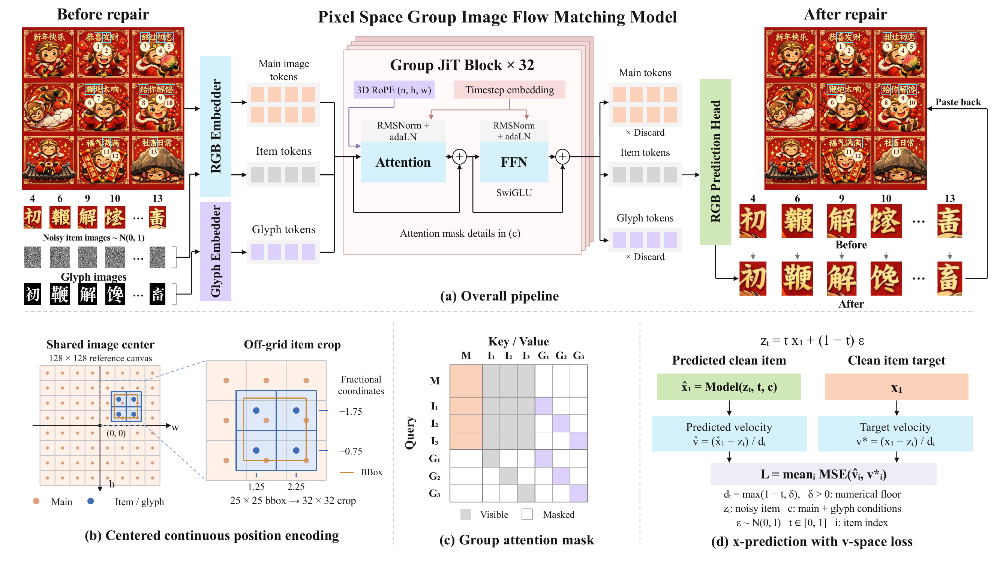
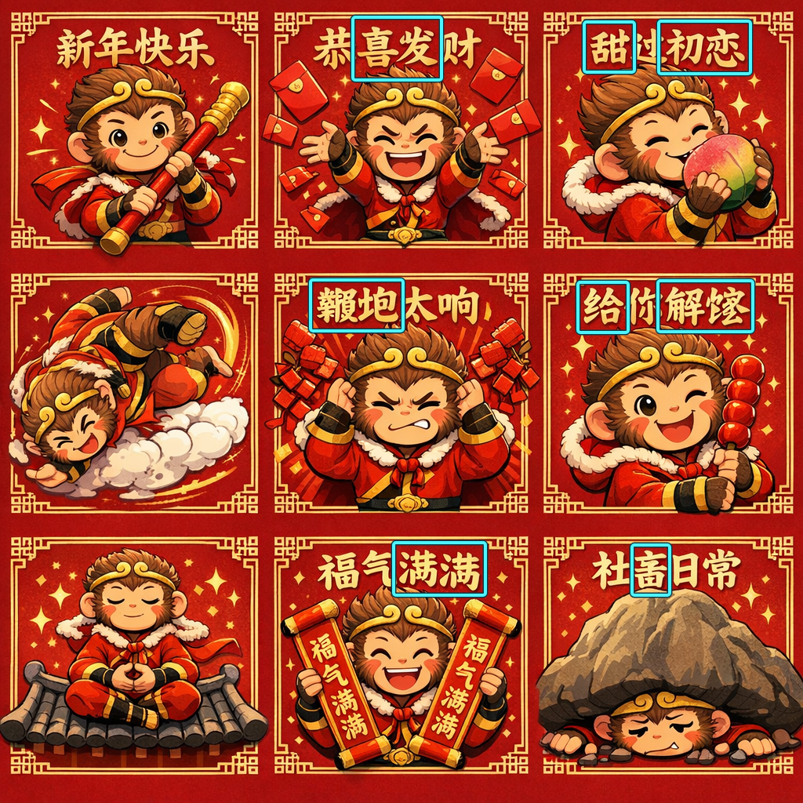
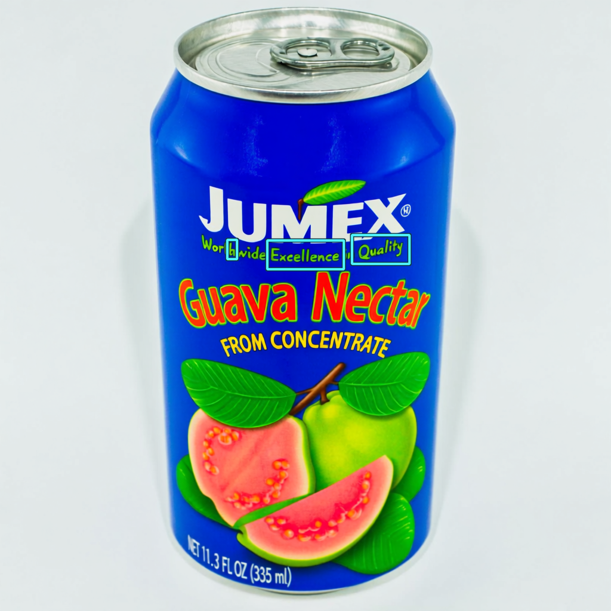
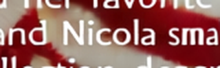
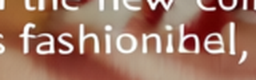
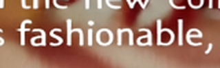
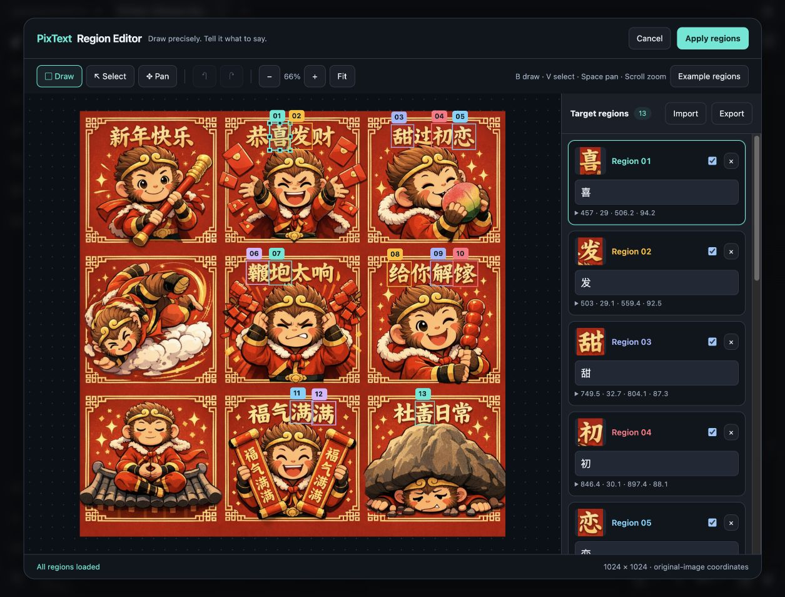
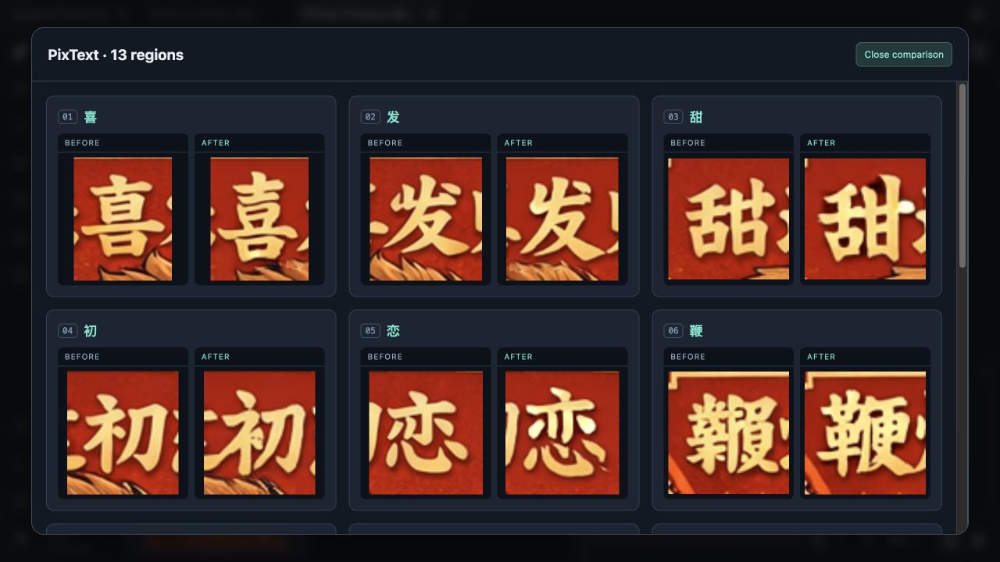
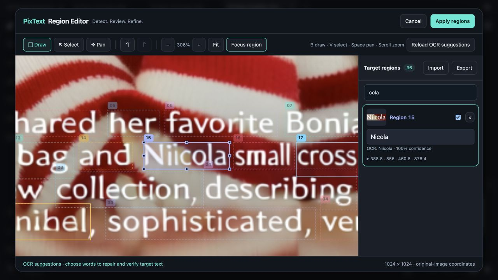
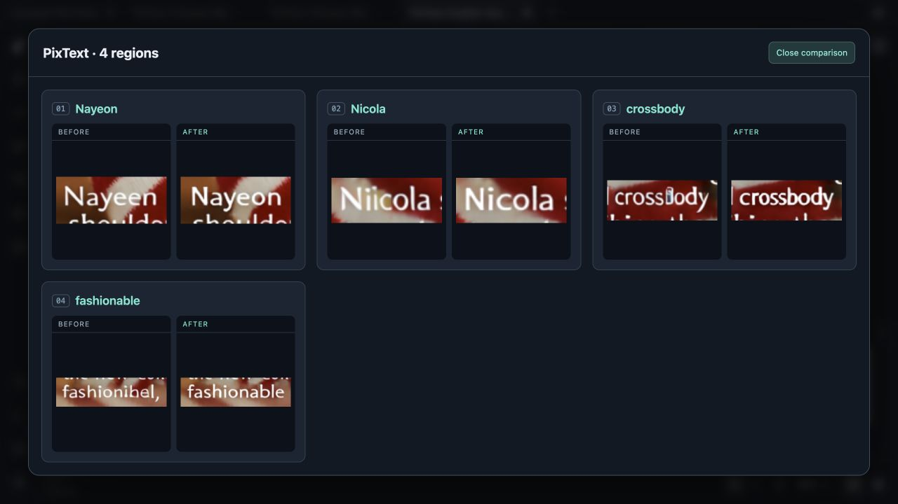

# PixText: Efficient Scene-Text Refinement via Pixel-Space Grouped Image Generation

[](https://arxiv.org/abs/2610.18284)
[](LICENSE)
[](https://huggingface.co/ATH-MaaS/PixText)
[](https://huggingface.co/datasets/ATH-MaaS/TextRefinementBench)

[](https://registry.comfy.org/publishers/yaoliliu/nodes/pixtext)



**English** | [简体中文](README.zh-CN.md)

PixText refines local text in pixel space. Provide an image, the regions to edit, and the target text. The model generates those regions using the image as context and preserves pixels outside the actual edited footprints. Multiple targets are generated jointly.

| Model | Default sampling | Glyph guidance |
| --- | --- | --- |
| PixText-Teacher | 25-step Euler | 3.3 |
| PixText-MeanFlow | 4-step interval Euler | 3.3 |

MeanFlow is the default quick-start choice. Each model package contains its weights, configuration, fonts and SHA-256 checksums. MeanFlow needs no additional text encoder, OCR model, VAE, or teacher.

## Example

Two input images and their targets are bundled in [`examples/`](examples). Cyan boxes mark the edited regions. Click an image to enlarge it.

| Input | MeanFlow · 4 steps | Teacher · 25 steps |
| --- | --- | --- |
| [](examples/pipeline_case/input_boxed.png) | [](examples/pipeline_case/meanflow_output_boxed.png) | [](examples/pipeline_case/teacher_output_boxed.png) |

Each row pairs two targets; every target shows input, MeanFlow output and Teacher output.

| # | Input | MeanFlow · 4 steps | Teacher · 25 steps | # | Input | MeanFlow · 4 steps | Teacher · 25 steps |
| --- | --- | --- | --- | --- | --- | --- | --- |
| 1&nbsp;喜 |  |  |  | 8&nbsp;给 |  |  |  |
| 2&nbsp;发 |  |  |  | 9&nbsp;解 |  |  |  |
| 3&nbsp;甜 |  |  |  | 10&nbsp;馋 |  |  |  |
| 4&nbsp;初 |  |  |  | 11&nbsp;满 |  |  |  |
| 5&nbsp;恋 |  |  |  | 12&nbsp;满 |  |  |  |
| 6&nbsp;鞭 |  |  |  | 13&nbsp;畜 |  |  |  |
| 7&nbsp;炮 |  |  |  |  |  |  |  |

**English caption repair.** [`examples/english_case`](examples/english_case) repairs four damaged words in a printed caption, including a misspelled name.

| Input | MeanFlow · 4 steps | Teacher · 25 steps |
| --- | --- | --- |
| [](examples/english_case/input_boxed.png) | [](examples/english_case/meanflow_output_boxed.png) | [](examples/english_case/teacher_output_boxed.png) |

Each row shows one repaired word: input, MeanFlow output and Teacher output.

| Word | Input | MeanFlow · 4 steps | Teacher · 25 steps |
| --- | --- | --- | --- |
| Nayeen → Nayeon |  |  |  |
| Nicola |  |  |  |
| crossbody |  |  |  |
| fashionable |  |  |  |

After [installation](#installation), place the complete MeanFlow model package in `models/PixText-MeanFlow` as described in [Model packages](#model-packages), then run:

```bash
python examples/run_pipeline.py                  # pipeline_case
python examples/run_pipeline.py --case english   # english_case
```

Results are saved to `outputs/<case>/meanflow.png`, with reproduction metadata in the adjacent JSON file. To run Teacher, prepare `models/PixText-Teacher` and add `--variant teacher`. Use `--model PATH` for a package stored elsewhere and `--output-dir PATH` to choose the output directory. All cases use seed 42.

Full-resolution images: [pipeline input](examples/pipeline_case/input.png), [MeanFlow](examples/pipeline_case/meanflow_output.png), [Teacher](examples/pipeline_case/teacher_output.png); [caption input](examples/english_case/input.png), [MeanFlow](examples/english_case/meanflow_output.png), [Teacher](examples/english_case/teacher_output.png). Run `python examples/annotate_pipeline.py --case <pipeline|english>` to rebuild the annotated SVG and PNG images.

## ComfyUI

Install the Registry package **`pixtext`** (publisher: **`yaoliliu`**) from ComfyUI Manager, or run `comfy node install pixtext`. Then download a model package as described below. The source installation steps remain available for development.

Draw rectangles directly on your image and enter the intended words in the **PixText Region Editor**. Five PixText nodes handle model loading, optional word detection, region editing, refinement and per-region comparison. Results connect to standard ComfyUI image nodes.



1. In your ComfyUI environment, install the custom nodes:

   ```bash
   cd ComfyUI/custom_nodes
   git clone https://github.com/ATH-MaaS/PixText.git
   python -m pip install -r PixText/requirements.txt
   ```

   Use the Python executable that runs ComfyUI. Its existing PyTorch, torchvision, NumPy, Pillow and safetensors installations are reused. A CUDA GPU and a working Triton compiler are required.
2. Download a complete package from [Hugging Face](https://huggingface.co/ATH-MaaS/PixText) into `ComfyUI/models/pixtext/PixText-MeanFlow/` or `ComfyUI/models/pixtext/PixText-Teacher/`. Include its configuration, manifest and fonts alongside the weights.
3. Restart ComfyUI and refresh your browser tab. Open **Templates → PixText**, or drag in [Chinese · MeanFlow](example_workflows/PixText-Chinese-MeanFlow.json) or [Chinese · Teacher](example_workflows/PixText-Chinese-Teacher.json). Both workflows contain the Chinese example image and all 13 targets; no image upload is needed for the example.
4. Click **Open Region Editor**. Draw a box, type its target text, and choose **Apply regions**. Save the workflow to retain your changes, then click **Run**.

The editor supports zoom, pan, moving/resizing boxes, undo/redo, per-region enable switches, coordinate adjustment and JSON import/export. **B** draws, **V** selects, **Space** pans, and the mouse wheel zooms. Clicking any existing box selects it and scrolls the matching target card into view; **Focus region** centers the selected box. Targets use original-image coordinates even while zoomed. The **Example regions** button restores the 13 Chinese targets. Uploading another image starts a separate annotation set.

For upstream images, connect an `IMAGE` to the editor's optional `image_in` input, run once to refresh its preview, then open the editor and apply regions. Connect the editor's `image` and `targets` outputs to **Refine Text · PixText**. It accepts one image at a time; use the Python API for image batches. No enabled regions returns the input unchanged.

The Refine node shows its own live sampling progress, including completed steps and the total across grouped passes. The workflow displays the actual sampling steps: **4 for MeanFlow, 25 for Teacher**. Switching between these standard model packages updates the recommended value; custom step counts are retained. More than 12 targets are grouped automatically. `edit_footprint` is a mask of the actual processed area, which can extend beyond the drawn boxes; pixels outside it are preserved. Models participate in ComfyUI's loading/offloading, and running jobs can be interrupted between sampling steps.

**Compare Regions · PixText** shows matching before/after crops for every enabled target, labeled with its number and target text. Use **Open comparison** for a larger gallery. The optional `padding` adds the same context to both crops; its `contact_sheet` output can connect to Save Image. The example workflows already include this node.



### English workflow with automatic word boxes

[English · Auto Detect](example_workflows/PixText-English-AutoDetect.json) uses the caption example above. **Detect Words · PixText** runs [CRAFT](https://github.com/clovaai/CRAFT-pytorch) through EasyOCR's detector and the official [PP-OCRv6 medium ONNX recognizer](https://huggingface.co/PaddlePaddle/PP-OCRv6_medium_rec_onnx) locally on CPU. Install the optional dependencies and models once, using ComfyUI's Python:

```bash
cd ComfyUI/custom_nodes/PixText
python -m pip install -r requirements-ocr.txt
python scripts/download_ocr_models.py --output ../../models/pixtext_ocr
```

Restart ComfyUI and refresh the browser, then load the English workflow:

1. **Run** once to detect and recognize words. Refinement waits for your review. The supplied image produces 36 candidate regions with the workflow's thresholds; detections can include false positives or split words.
2. **Open Region Editor**. The detected boxes and recognized text appear automatically, with confidence values. Search for a word to find its card; use **Focus region** to inspect it closely; correct the target text, adjust its box, delete unwanted detections, or draw a missing region. Editing an OCR target automatically enables it; switches also work manually. Unchanged detections start disabled.
3. For this example, change `Nayeen` → `Nayeon`, `Niicola` → `Nicola`, `crossBody` → `crossbody`, and the word starting `fashion` → `fashionable`. OCR confidence measures recognition of the visible image, not whether the spelling is correct. For this tightly spaced caption, set the `Nayeon` box’s `y1` to 853 and the `fashionable` box’s `x1` to 344 to exclude the next line and the trailing comma. Keep the remaining regions disabled.
4. **Apply regions**, save the workflow, then **Run** again. The comparison node shows each selected word before and after repair. Later runs retain your saved boxes and target text. **Reload OCR suggestions** explicitly replaces the editor's current list and supports Undo.

For another image, upload it in **Detect Words**, or connect its optional `image_in`. Connect both its `image` and `detections` outputs to the editor. New images or changed OCR results require review again. A lower `link_threshold` joins more character fragments; raise it if adjacent words merge. The English example uses 0.2 to keep damaged words together. Boxes are axis-aligned repair targets derived from CRAFT quadrilaterals; rotated text may need manual adjustment. This workflow offers word-level suggestions; the Chinese workflow retains its manually reviewed character targets. Model downloads are explicit and checksum-verified; inference sends no images to an external OCR service.





For headless OCR, submit the [English API workflow](comfyui/workflows/english-autodetect-api.json) once, then copy node 2’s `ocr_suggestions[0]` from the history UI data into its `region_data` JSON string. Set the intended target text and `enabled` flags, retain its `detection_id`, and resubmit for refinement.

Headless examples: [MeanFlow API workflow](comfyui/workflows/chinese-meanflow-api.json), [Teacher API workflow](comfyui/workflows/chinese-teacher-api.json). Tested with ComfyUI 0.42.0, frontend 1.57.1, PyTorch 2.8.0 and Pillow 13.0.0.

## Installation

Use Python 3.11 or newer and a CUDA GPU. The dependencies are specified in [`pyproject.toml`](pyproject.toml), including PyTorch 2.8.0, torchvision 0.23.0 and Pillow 13.0.0. Install a CUDA build of PyTorch and torchvision appropriate for your machine, then install PixText:

```bash
pip install -e .
```

Pillow must support RAQM. The system must provide HarfBuzz (`libharfbuzz0` on Debian/Ubuntu). Font files are loaded from the model package; no system font installation is required.

## Model packages

Download model weights from [Hugging Face](https://huggingface.co/ATH-MaaS/PixText). The examples require complete local model packages arranged as follows:

```text
models/
  PixText-Teacher/
  PixText-MeanFlow/
    model.safetensors
    config.json
    inference_config.json
    manifest.json
    README.md
    fonts/
      AlibabaPuHuiTi-3-55-Regular.ttf
      GoNotoCJKCore-v7.0.ttf
```

Teacher uses the same package layout. [`model_index.json`](model_index.json) lists the model identifiers and weight checksums. `from_pretrained` loads a local directory and checks the files listed in its manifest, including the weights, configuration and fonts.

## Python

```python
from pixtext import PixTextPipeline, TextEdit

pipeline = PixTextPipeline.from_pretrained("models/PixText-MeanFlow")
result = pipeline.edit(
    "input.png",
    edits=[TextEdit(bbox=(120, 80, 160, 125), text="鹿")],
    seed=42,
)
result.image.save("output.png")
```

Use `models/PixText-Teacher` to load Teacher. Both variants can coexist in one process. Results contain `image` and `metadata`, including model identity, seed, sample identity, sampling settings, and crop geometry.

## Command line

Create `edits.json`:

```json
[{"bbox": [120, 80, 160, 125], "text": "鹿"}]
```

```bash
pixtext --model models/PixText-MeanFlow \
  --image input.png --edits edits.json --output output.png --seed 42
```

The CLI saves a PNG and a matching JSON metadata file. `python -m pixtext` provides the same command. `--steps` and `--guidance-scale` override the package defaults.

## Batch editing

```python
results = pipeline.edit_batch(
    ["first.png", "second.png"],
    [
        [TextEdit((120, 80, 160, 125), "鹿")],
        [TextEdit((20, 30, 100, 70), "PixText")],
    ],
    seeds=[42, 43],
    sample_ids=["first", "second"],
)
```

Each image has independent noise and blur streams.

## Inputs and pixel preservation

- Inputs are Pillow images or local image paths, converted to upright RGB using EXIF orientation. Coordinates refer to that upright image.
- Boxes use original-image pixel coordinates `(x0, y0, x1, y1)` and half-open intervals.
- Supply one character or a text line per target.
- Crops align to 16-pixel patches. The edited footprint may extend beyond the requested box. Pixels outside those footprints remain identical to the original RGB image.
- Arbitrary image dimensions are supported.
- Targets are processed in input order, up to 12 per pass.
- The renderer selects the first bundled font covering the entire target string, using PuHuiTi then Go Noto.

Glyph-present and glyph-absent predictions provide guidance on the open interval `(0.1, 1.0)`. At the default guidance setting, four MeanFlow updates use seven model forwards.

## Development

```bash
pip install -e '.[dev]'
ruff check src tests scripts
ruff format --check src tests scripts
mypy
pytest
python3 scripts/check_secrets.py --tracked
```

GPU tests require CUDA and local model packages. Set `PIXTEXT_TEST_MODELS` if packages are stored elsewhere.

## License

PixText is released under the Apache License 2.0. See [LICENSE](LICENSE).
