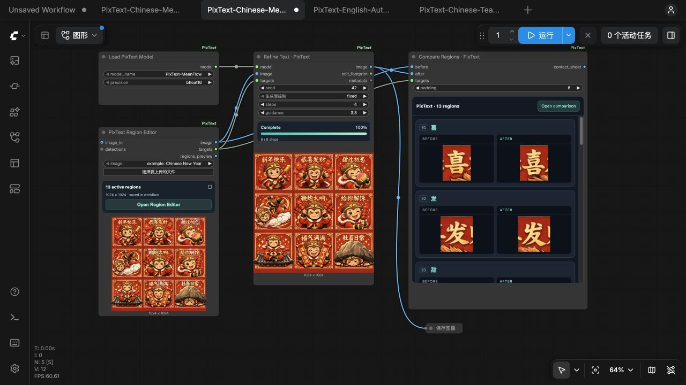
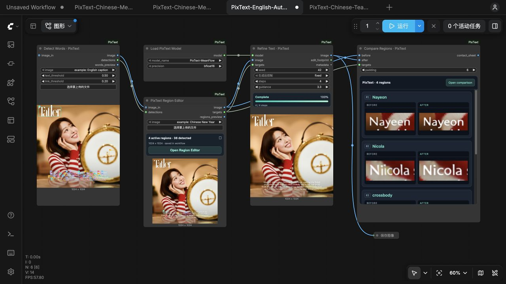

# PixText: Efficient Scene-Text Refinement via Pixel-Space Grouped Image Generation

[](https://arxiv.org/abs/2610.18284)
[](LICENSE)
[](https://huggingface.co/ATH-MaaS/PixText)
[](https://huggingface.co/datasets/ATH-MaaS/TextRefinementBench)
[](https://registry.comfy.org/publishers/yaoliliu/nodes/pixtext)


[English](README.md) | **简体中文**

PixText 用来修复图片中的文字。框出要改的文字，填入目标字词，模型会结合周围图像，在像素空间中一起修复这些区域。实际编辑范围之外的像素保持不变。

| 模型 | 默认采样方式 | 字形引导强度 |
| --- | --- | --- |
| PixText-Teacher | 25 步 Euler | 3.3 |
| PixText-MeanFlow | 4 步区间 Euler | 3.3 |

建议先用 MeanFlow。模型包自带权重、配置、字体和 SHA-256 校验信息，运行 MeanFlow 无需额外的文本编码器、OCR 模型、VAE 或 Teacher。

## 示例

两个示例的原图和目标文字都在 [`examples/`](examples) 中。青色框标出编辑区域，点击图片可查看大图。

| 输入 | MeanFlow · 4 步 | Teacher · 25 步 |
| --- | --- | --- |
| [](examples/pipeline_case/input_boxed.png) | [](examples/pipeline_case/meanflow_output_boxed.png) | [](examples/pipeline_case/teacher_output_boxed.png) |

| # | Input | MeanFlow · 4 steps | Teacher · 25 steps | # | Input | MeanFlow · 4 steps | Teacher · 25 steps |
| --- | --- | --- | --- | --- | --- | --- | --- |
| 1&nbsp;喜 |  |  |  | 8&nbsp;给 |  |  |  |
| 2&nbsp;发 |  |  |  | 9&nbsp;解 |  |  |  |
| 3&nbsp;甜 |  |  |  | 10&nbsp;馋 |  |  |  |
| 4&nbsp;初 |  |  |  | 11&nbsp;满 |  |  |  |
| 5&nbsp;恋 |  |  |  | 12&nbsp;满 |  |  |  |
| 6&nbsp;鞭 |  |  |  | 13&nbsp;畜 |  |  |  |
| 7&nbsp;炮 |  |  |  |  |  |  |  |

英文示例 [`examples/english_case`](examples/english_case) 修复了一段印刷说明文字中的四个单词，其中一个是拼错的人名，其余文字保持不变。

| 输入 | MeanFlow · 4 步 | Teacher · 25 步 |
| --- | --- | --- |
| [](examples/english_case/input_boxed.png) | [](examples/english_case/meanflow_output_boxed.png) | [](examples/english_case/teacher_output_boxed.png) |

| 单词 | 输入 | MeanFlow · 4 步 | Teacher · 25 步 |
| --- | --- | --- | --- |
| Nayeen → Nayeon |  |  |  |
| Nicola |  |  |  |
| crossbody |  |  |  |
| fashionable |  |  |  |

运行示例前，先[安装 PixText](#安装)，按[模型包](#模型包)说明把完整的 MeanFlow 模型包放到 `models/PixText-MeanFlow`，再执行：

```bash
python examples/run_pipeline.py                  # pipeline_case
python examples/run_pipeline.py --case english   # english_case
```

脚本把结果保存到 `outputs/<case>/meanflow.png`，并在旁边的 JSON 文件中记录复现信息。要运行 Teacher，准备好 `models/PixText-Teacher`，加上 `--variant teacher` 即可。模型包放在其他位置时，用 `--model PATH` 指定；用 `--output-dir PATH` 更改结果的保存目录。两个示例都使用随机种子 42。

原图与完整结果：[pipeline 输入](examples/pipeline_case/input.png)、[MeanFlow 输出](examples/pipeline_case/meanflow_output.png)、[Teacher 输出](examples/pipeline_case/teacher_output.png)；[说明文字输入](examples/english_case/input.png)、[MeanFlow 输出](examples/english_case/meanflow_output.png)、[Teacher 输出](examples/english_case/teacher_output.png)。需要重新生成带标注的 SVG 和 PNG 图片时，运行 `python examples/annotate_pipeline.py --case <pipeline|english>`。

## ComfyUI

在图片上框出要改的文字，填入目标字词，运行后就能逐个区域查看修复前后的对比。

### 安装节点

1. 在运行 ComfyUI 的 Python 环境中克隆节点并安装依赖：

   ```bash
   cd ComfyUI/custom_nodes
   git clone https://github.com/ATH-MaaS/PixText.git
   python -m pip install -r PixText/requirements.txt
   ```

2. 重启 ComfyUI，刷新浏览器。在 **模板 → PixText** 中打开示例，或把下面的工作流文件拖入画布。缺少权重时，ComfyUI 会显示模型名称和下载链接。配置和字体随节点提供。文字修复需要 NVIDIA CUDA GPU。
3. 点击缺失模型弹窗中的 **Download**。Desktop 会处理下载；浏览器或 Portable 安装请将文件保存为 `ComfyUI/models/diffusion_models/PixText-MeanFlow.safetensors` 或 `ComfyUI/models/diffusion_models/PixText-Teacher.safetensors`。连接远程服务器时，要把文件放到服务器上。保存后刷新模型列表。原先放在 `ComfyUI/models/pixtext/` 或 `ComfyUI/models/` 下的完整模型包也可以继续使用。

### 中文 · 手动画框修复

[下载 MeanFlow 工作流](example_workflows/PixText-Chinese-MeanFlow.json) · [Teacher 版本](example_workflows/PixText-Chinese-Teacher.json)



1. 在 **Load PixText Model** 中选好模型。示例自带原图和 13 个文字区域，MeanFlow 默认采样 4 步，Teacher 默认 25 步。
2. 点击 **Open Region Editor**，画框或调整已有的框，填入目标文字。完成后点击 **Apply regions**。
3. 点击 **运行**，在 **Compare Regions** 中检查每个区域的修复结果。点击 **Open comparison** 可打开完整画廊。保存工作流时，框和目标文字也会一起保存。

### 英文 · 自动检测后微调

[下载 Auto Detect 工作流](example_workflows/PixText-English-AutoDetect.json)



先在运行 ComfyUI 的 Python 环境中安装 OCR 依赖：

```bash
cd ComfyUI/custom_nodes/PixText
python -m pip install -r requirements-ocr.txt
```

重启 ComfyUI，打开英文工作流：

1. 按画布上的 **OCR model downloads** 备注下载三个 OCR 文件，放到备注列出的目录，再点击 **运行**，检测单词框并识别文字。[OCR 模型安装](docs/ocr-models.zh-CN.md) 中也有相同的链接和本地校验命令。
2. 打开 **Region Editor**，微调框和目标词。示例中的目标词是 `Nayeon`、`Nicola`、`crossbody` 和 `fashionable`。勾选要修复的区域，再点击 **Apply regions**。
3. 再次点击 **运行**，修复所选单词并查看对比结果。换用自己的图片时，在 **Detect Words** 中上传即可。

## 安装

PixText 需要 Python 3.11 或更高版本和 CUDA GPU。[`pyproject.toml`](pyproject.toml) 列出了依赖，包括 PyTorch 2.8.0、torchvision 0.23.0 和 Pillow 11.3.0 或更高版本。先为本机 CUDA 环境安装 PyTorch 和 torchvision，再安装 PixText：

```bash
pip install -e .
```

PixText 使用支持 RAQM 的 Pillow 对目标文字排版，渲染出提供给模型的字形条件图。系统中还需要 HarfBuzz（Debian/Ubuntu 中为 `libharfbuzz0`）。ComfyUI 节点和 Python 模型包都自带字体，不用另外安装系统字体。

## 模型包

从 [Hugging Face](https://huggingface.co/ATH-MaaS/PixText) 下载完整模型包。运行 Python 示例时，按以下目录放置：

```text
models/
  PixText-Teacher/
  PixText-MeanFlow/
    model.safetensors
    config.json
    inference_config.json
    manifest.json
    README.md
    fonts/
      AlibabaPuHuiTi-3-55-Regular.ttf
      GoNotoCJKCore-v7.0.ttf
```

Teacher 的目录结构相同。[`model_index.json`](model_index.json) 中列有模型标识和权重校验值。`from_pretrained` 从本地目录加载模型，并检查清单中的权重、配置和字体。

## Python 接口

```python
from pixtext import PixTextPipeline, TextEdit

pipeline = PixTextPipeline.from_pretrained("models/PixText-MeanFlow")
result = pipeline.edit(
    "input.png",
    edits=[TextEdit(bbox=(120, 80, 160, 125), text="鹿")],
    seed=42,
)
result.image.save("output.png")
```

使用 Teacher 时，把模型路径换成 `models/PixText-Teacher`。两种模型可以在同一个进程里使用。返回结果中的 `image` 是修复后的图片，`metadata` 记录模型标识、随机种子、样本标识、采样设置和裁剪区域。

## 命令行

创建 `edits.json`：

```json
[{"bbox": [120, 80, 160, 125], "text": "鹿"}]
```

```bash
pixtext --model models/PixText-MeanFlow \
  --image input.png --edits edits.json --output output.png --seed 42
```

命令会保存 PNG 图片和同名 JSON 元数据文件，也可以用 `python -m pixtext` 调用。通过 `--steps` 和 `--guidance-scale` 更改模型包的默认设置。

## 批量编辑

```python
results = pipeline.edit_batch(
    ["first.png", "second.png"],
    [
        [TextEdit((120, 80, 160, 125), "鹿")],
        [TextEdit((20, 30, 100, 70), "PixText")],
    ],
    seeds=[42, 43],
    sample_ids=["first", "second"],
)
```

每张图片使用独立的噪声和模糊随机流。

## 输入与像素保留规则

- 输入 Pillow 图片或本地图片路径。PixText 按 EXIF 方向把图片转正，再转换为 RGB，编辑坐标以转正后的图片为准。
- 用原图像素坐标 `(x0, y0, x1, y1)` 指定编辑框，区间左闭右开。
- 一个目标可以是单个字符，也可以是一行文字。
- 裁剪区域按 16 像素的 patch 对齐，实际编辑范围可能超出指定框。范围以外的像素与原始 RGB 图片完全一致。
- 支持任意图片尺寸。
- 目标按输入顺序处理，每轮最多 12 个。
- 每个目标依次尝试普惠体和 Go Noto，使用第一个能覆盖整条文字的字体。

字形引导在开区间 `(0.1, 1.0)` 内组合有字形和无字形条件的预测。使用默认引导设置时，MeanFlow 的 4 次更新需要 7 次模型前向计算。

## 开发

```bash
pip install -e '.[dev]'
ruff check src tests scripts
ruff format --check src tests scripts
mypy
pytest
python3 scripts/check_secrets.py --tracked
```

GPU 测试需要 CUDA 和本地模型包。如果模型包放在其他目录，用 `PIXTEXT_TEST_MODELS` 指定。

## 引用

如果在研究中使用 PixText，请引用：

```bibtex
@misc{liu2026efficientscenetextrefinementpixelspace,
  title={Efficient Scene-Text Refinement via Pixel-Space Grouped Image Generation},
  author={Yaoli Liu and Guo-Hua Wang and Yiyang Chen and Qing-Guo Chen and Zhao Xu and Weihua Luo and Yao-Xiang Ding},
  year={2026},
  eprint={2610.18284},
  archivePrefix={arXiv},
  primaryClass={cs.CV},
  url={https://arxiv.org/abs/2610.18284},
}
```

## 许可

PixText 以 Apache License 2.0 发布，详见 [LICENSE](LICENSE)。
